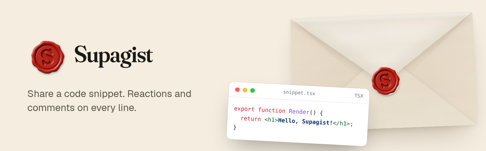

<picture>
  <source media="(prefers-color-scheme: dark)" srcset="./assets/brand/readme/readme-banner-dark.png">
  
</picture>

<p align="center"><strong>Share a code snippet. Reactions and comments on every line.</strong></p>

<p align="center">
  <a href="./LICENSE"></a>
  <a href="https://github.com/leandrocp/supagist/actions/workflows/ci.yml"></a>
  <a href="https://supagist.app"></a>
  <a href="#mcp"></a>
</p>

<p align="center">
  <a href="https://supagist.app">Website</a> ·
  <a href="#mcp">MCP</a> ·
  <a href="#cli">CLI</a> ·
  <a href="#agent-skill">Agent skill</a> ·
  <a href="./CONTRIBUTING.md">Contributing</a>
</p>

## What it is

Supagist is a place to share code and talk about it line by line. Paste a snippet, get a link, and anyone with the link can react to or comment on the exact line they mean. You can also turn a snippet into a polished image, or have your coding agent do it for you.

- Per-line reactions and comments. Click a line, pick an emoji or start a thread.
- Live presence. The status bar shows who is reading the snippet right now.
- Syntax highlighting by [Lumis](https://lumis.sh): 100+ languages and plenty of themes.
- Image export as PNG or SVG, with brand presets, backgrounds and fonts.
- An [MCP server](#mcp) and a [CLI](#cli) so coding agents and scripts can render code images.

## Getting started

### Website

Open [supagist.app](https://supagist.app), paste your code, and share the link. Reading is free. Sign in with GitHub or email to react and comment.

### MCP

The Supagist MCP server renders code as SVG from your coding agent. It speaks Streamable HTTP and signs you in with OAuth, so there is no API key to copy. Endpoint:

```text
https://supagist.app/mcp
```

Add it to your client, then sign in with your Supagist account when the client asks.

**Claude Code**

```sh
claude mcp add --transport http supagist https://supagist.app/mcp
```

Then run `/mcp` inside Claude Code, pick `supagist`, and authenticate.

**Cursor** — add this to `~/.cursor/mcp.json` (or `.cursor/mcp.json` in a project):

```json
{
  "mcpServers": {
    "supagist": { "url": "https://supagist.app/mcp" }
  }
}
```

**Amp**

```sh
amp mcp add supagist https://supagist.app/mcp
```

**Codex**

```sh
codex mcp add supagist --url https://supagist.app/mcp
codex mcp login supagist
```

**VS Code** — add this to `.vscode/mcp.json`:

```json
{
  "servers": {
    "supagist": { "type": "http", "url": "https://supagist.app/mcp" }
  }
}
```

Tools:

| Tool             | What it does                                                                                                                      |
| ---------------- | --------------------------------------------------------------------------------------------------------------------------------- |
| `render_snippet` | Renders code as an SVG code image. Supports brand presets, themes, fonts, backgrounds, window chrome, line numbers and more.      |
| `list_options`   | Lists every supported language, theme, brand, background, font and limit. Call it first if you are unsure which values are valid. |

Rendering publishes nothing and is rate limited per account.

### CLI

The `supagist` CLI renders a file or stdin to an SVG or PNG image from the terminal. It is not published to npm yet, so run it from a clone of this repository (Node.js 22 or later, no install step):

```sh
git clone https://github.com/leandrocp/supagist
cd supagist
node packages/cli/bin/supagist.js packages/cli/src/args.js --lines 1-20 --brand supabase --out code.png
cat main.rs | node packages/cli/bin/supagist.js - --filename main.rs --theme dracula --out card.svg
node packages/cli/bin/supagist.js options
```

See the [CLI README](./packages/cli/README.md) for every flag, JSON output and limits. Your code is sent to the Supagist render API to be drawn and nothing is stored, but don't render secrets.

### Agent skill

```sh
npx skills add leandrocp/supagist --skill supagist
```

The [skill](./.agents/skills/supagist/SKILL.md) teaches your coding agent to connect to the MCP server, save SVGs as real files, and convert them to PNG locally.

## Contributing

Want to run Supagist locally or send a change? See [CONTRIBUTING.md](./CONTRIBUTING.md). Architecture, operations and security notes live in [ARCHITECTURE.md](./ARCHITECTURE.md), [OPERATIONS.md](./OPERATIONS.md) and [SECURITY.md](./SECURITY.md).

## License

[MIT](./LICENSE). Syntax highlighting by [Lumis](https://lumis.sh).
