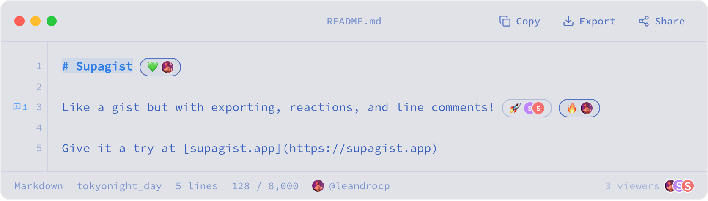
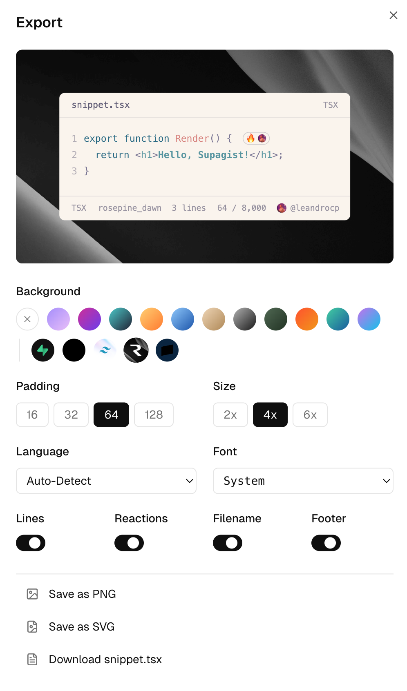

# Supagist

Share a code snippet. Reactions and comments on every line.



Live at **[supagist.app](https://supagist.app)**

## Features

- Per-line reactions. Click a line, pick an emoji. Other readers' reactions show next to yours.
- Per-line comments. Each line gets its own thread.
- Live presence. The status bar shows who's reading the snippet right now.
- Syntax highlighting via [Lumis](https://lumis.sh). 100+ languages, plenty of themes.
- Export as PNG or SVG, with optional gradient backgrounds and font choices.
- Sign in with GitHub or email. Reading is free; reacting and commenting need an account.

<p align="center"></p>

## Supagist agent skill

The [Supagist skill](./.agents/skills/supagist/SKILL.md)
teaches coding agents to connect to Supagist over OAuth, save SVG exports as real
`.svg` files, and offer optional PNG conversion on the client machine. The skill
and MCP use SVG exclusively; PNG conversion runs locally, not in an Edge Function
or a separate hosted rendering service. The web app's export options are unchanged.

Install the skill from this repository:

```bash
npx skills add leandrocp/supagist --skill supagist
```

Installing the skill and connecting/authenticating the MCP server are separate
steps; the skill includes the connection instructions. PNG conversion requires
Node.js 22+ and explicit approval to install its isolated resvg dependency.
It never adds dependencies to the user's application or uploads SVGs for conversion.

For maintainers, validate discovery before publishing:

```bash
DISABLE_TELEMETRY=1 npx skills add . --list --skill supagist
```

The skill follows the [skills.sh GitHub distribution format](https://github.com/vercel-labs/skills/blob/main/docs/creating-skills.md).
Preparing these files does not publish a directory listing or install the skill
for anyone. After release, verify the remote installation command above; do not
claim a skills.sh listing until it is visible there.

## Run locally

```bash
git clone https://github.com/leandrocp/supagist
cd supagist
mise install
mise run setup
mise run dev
```

App runs on `http://localhost:3000`. Studio at `http://127.0.0.1:54323`.

For GitHub OAuth in dev, set `SUPABASE_AUTH_GITHUB_CLIENT_ID` and `SUPABASE_AUTH_GITHUB_SECRET` in your shell. Or skip it and use email/password.

## Tests

```bash
mise run test
mise run test:integration
mise run test:e2e
```

## How it works

See [ARCHITECTURE.md](./ARCHITECTURE.md) for auth states, realtime channels, storage layout, the export pipeline, and URL design.

Release, monitoring, rollback, recovery, and incident procedures live in [OPERATIONS.md](./OPERATIONS.md). Dependency exceptions and vulnerability reporting guidance live in [SECURITY.md](./SECURITY.md).

## License

MIT.
